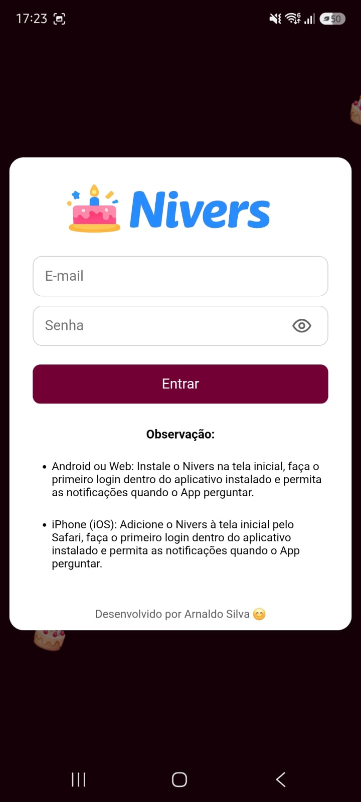
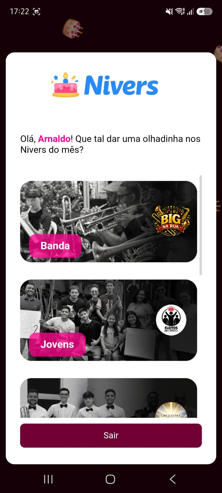
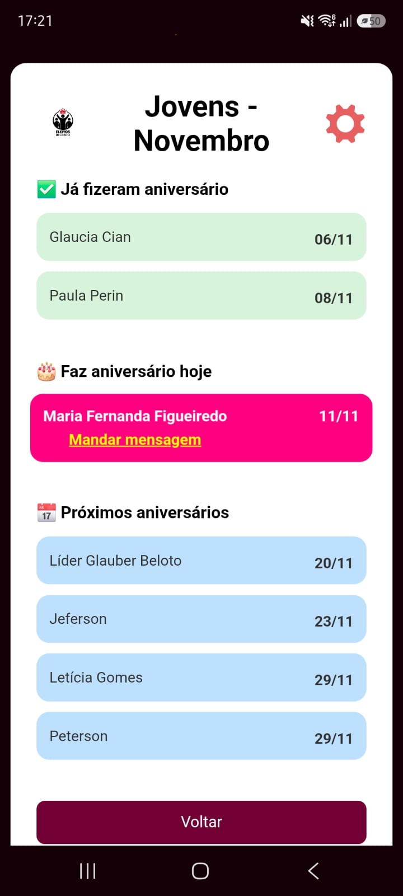
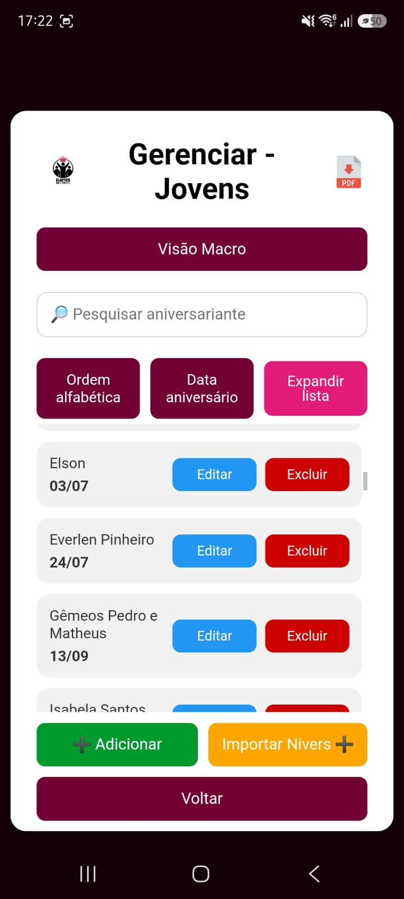
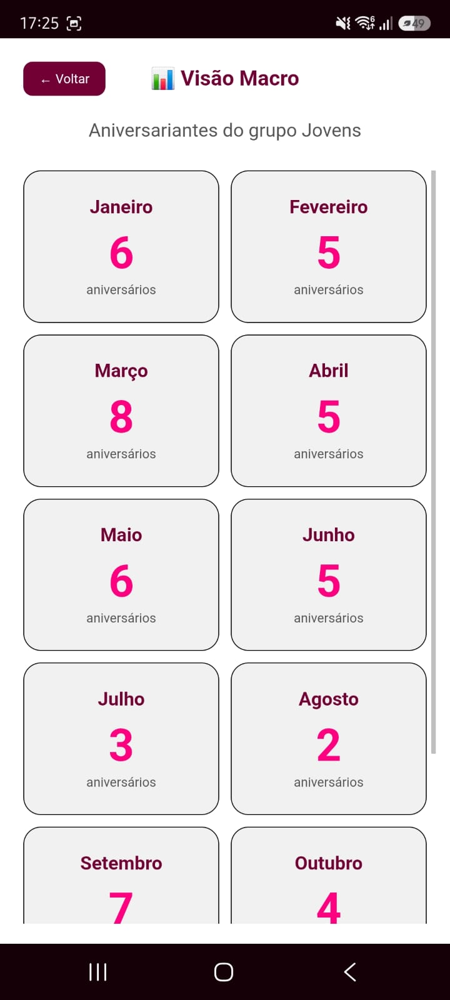
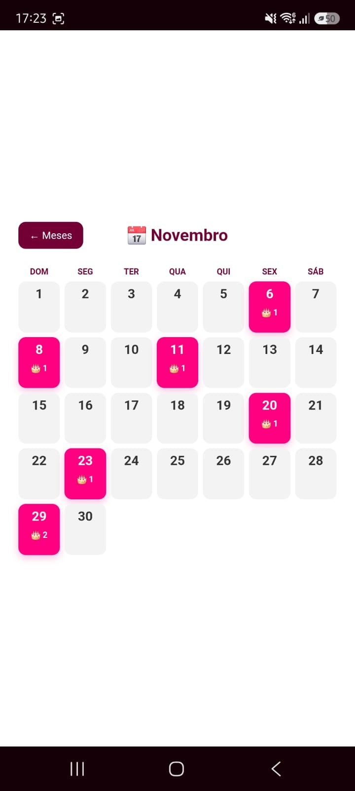
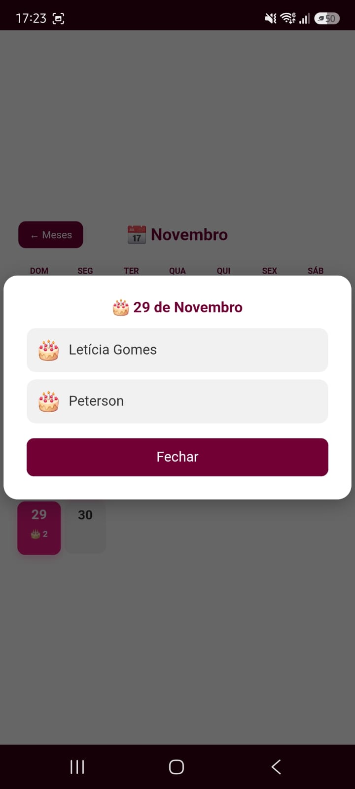

# 🎂 Nivers

O **Nivers** é um aplicativo web desenvolvido para facilitar a consulta e o gerenciamento de aniversários em grupos. A plataforma permite organizar aniversariantes por grupos, visualizar os aniversários do mês, cadastrar e importar listas de pessoas, além de enviar notificações automáticas nos dias de aniversário.

O projeto surgiu de uma necessidade real na minha igreja, onde cada departamento possui uma pessoa responsável por acompanhar os aniversários de seus integrantes e parabenizá-los na data correspondente. A proposta foi centralizar essas informações em uma única plataforma, simplificando a organização, evitando esquecimentos e tornando esse acompanhamento mais prático e eficiente.
## 📸 Capturas de tela

### Login

<!-- Coloque a imagem em docs/screenshots/login.png -->


### Página inicial e grupos

<!-- Coloque a imagem em docs/screenshots/inicio-grupos.png -->


### Aniversários do grupo

<!-- Coloque a imagem em docs/screenshots/aniversarios-grupo.png -->


### Gerenciamento

<!-- Coloque a imagem em docs/screenshots/gerenciamento.png -->


### Calendário e visão macro

<!-- Coloque a imagem em docs/screenshots/calendario.png -->
 

<!-- Coloque a imagem em docs/screenshots/calendario.png -->
 

<!-- Coloque a imagem em docs/screenshots/calendario.png -->
 

## ✨ Funcionalidades

- Login de usuários com **Firebase Authentication**.
- Acesso aos grupos conforme as permissões do usuário: Banda, Jovens, Orquestra, Coral, Adolescentes e Irmãs.
- Consulta mensal separada entre aniversários que já ocorreram, de hoje e próximos.
- Sugestão de mensagem de aniversário, pronta para copiar.
- Cadastro, edição, pesquisa, ordenação e remoção de aniversariantes dos grupos.
- Importação de listas com prévia e identificação de possíveis duplicidades.
- Visão macro anual e calendário mensal.
- Exportação da lista exibida em PDF.
- Instalação como **PWA** e recebimento de notificações push.

## 🛠️ Tecnologias

- HTML, CSS e JavaScript com módulos ES.
- Firebase Authentication.
- Cloud Firestore.
- Firebase Cloud Messaging.
- Cloud Functions for Firebase.
- Vite para desenvolvimento local.
- jsPDF para geração de arquivos PDF.

## ⚙️ Como funciona

O usuário entra com sua conta do Firebase Authentication. O aplicativo consulta seu cadastro na coleção `usuarios` do Firestore para obter seu nome e os grupos autorizados.

Os aniversariantes ficam na coleção `aniversariantes`, com nome, dia, mês e grupos associados. Na tela do grupo, o app mostra os aniversários do mês atual e os separa conforme a data.

A função agendada `enviarAniversarios`, em `functions/index.js`, consulta os aniversários do dia no fuso horário de São Paulo e envia notificações push aos usuários dos grupos correspondentes.

## 📁 Estrutura do projeto

```text
.
├── index.html                 # Tela de login
├── home.html                  # Página inicial e seleção de grupos
├── grupo.html                 # Aniversários do grupo
├── gerenciar.html             # Gerenciamento de aniversariantes
├── app.js                     # Autenticação e instalação do PWA
├── home.js                    # Grupos, sessão e tokens de notificação
├── grupo.js                   # Consulta e apresentação dos aniversários
├── gerenciar.js               # Cadastro, importação, calendário e PDF
├── firebase-config.js         # Inicialização do Firebase no navegador
├── firebase-messaging-sw.js   # Notificações recebidas em segundo plano
├── service-worker.js          # Service worker do PWA
├── style.css                  # Estilos e responsividade
├── image/                     # Imagens e logotipos
├── audio/                     # Áudios dos grupos
└── functions/
    └── index.js               # Função agendada de notificações
```

**🚀 Executar localmente**
* Pré-requisitos: Node.js e npm.
* Na pasta raiz do projeto, instale as dependências e inicie o servidor de desenvolvimento:
npm install
npm run dev
O front-end usa a configuração Firebase definida em firebase-config.js. As Cloud Functions têm dependências próprias na pasta functions/ e precisam ser configuradas e publicadas com a Firebase CLI.

**🔐 Dados e segurança**
* Os dados dos usuários e aniversariantes ficam no Cloud Firestore e não são armazenados neste repositório. O acesso a esses dados depende das regras de segurança configuradas no Firebase.
* A configuração Firebase incluída no front-end identifica o projeto, mas não substitui as regras de segurança. Antes de publicar alterações, confirme o projeto de destino indicado em .firebaserc.
```
